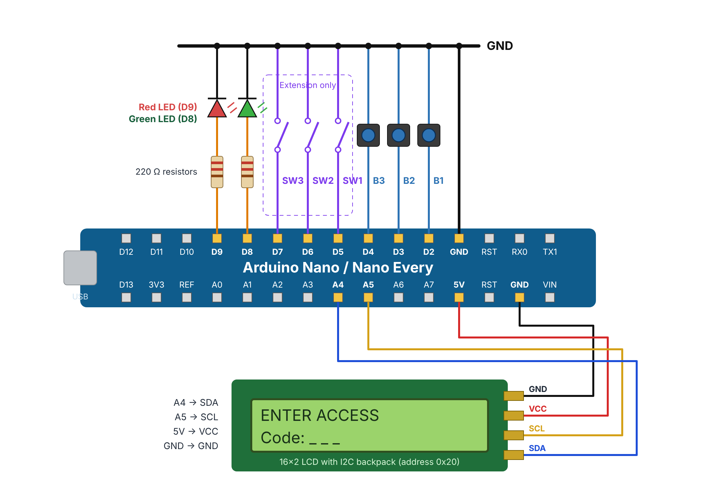

# Week 10 Lab — ET4047 Embedded Software

**Module:** ET4047 · **Author:** Luke Griffin
**University of Limerick — Department of Electronic & Computer Engineering**

🌐 **Open the lab online:** https://lukegrif.github.io/W10-LAB-ET4047/

---

## Lab 9: Secure Access Control with a Finite State Machine

Build a digital security lock on an Arduino Nano / Nano Every with three push
buttons, two LEDs and an LCD. Write it as a finite state machine, add a lockout
timed with `millis()`, then attack your own lock and make it stronger.

➡️ [Lab overview, tasks and code](Secure_Access_Control/README.md)

---

## Repository Contents

| Path | Description |
|------|-------------|
| `index.html` | GitHub Pages landing page |
| `viewer.html` | Renders the lab PDF (`viewer.html?lab=secure`) |
| `Secure_Access_Control/` | Lab document (PDF and Word), figures, and the code for every task in two versions: `Code/I2C_Backpack/` and `Code/Adafruit_RGB_Shield/` |
| `assets/` | University logos used on the landing page |
