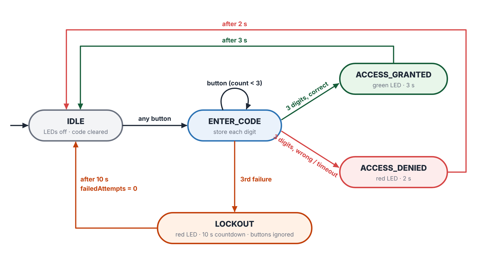
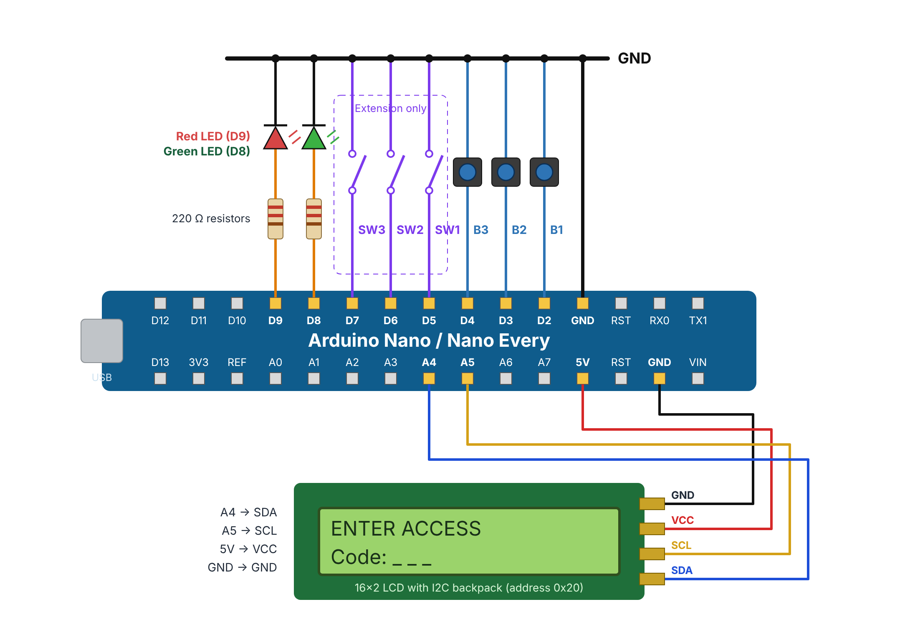
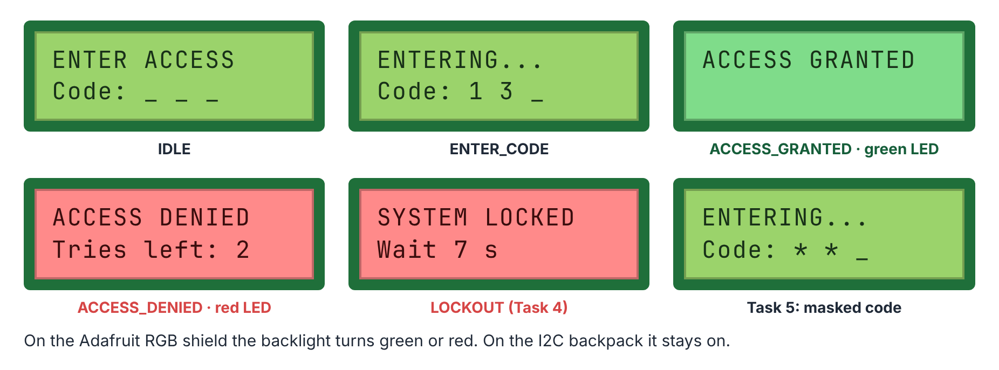
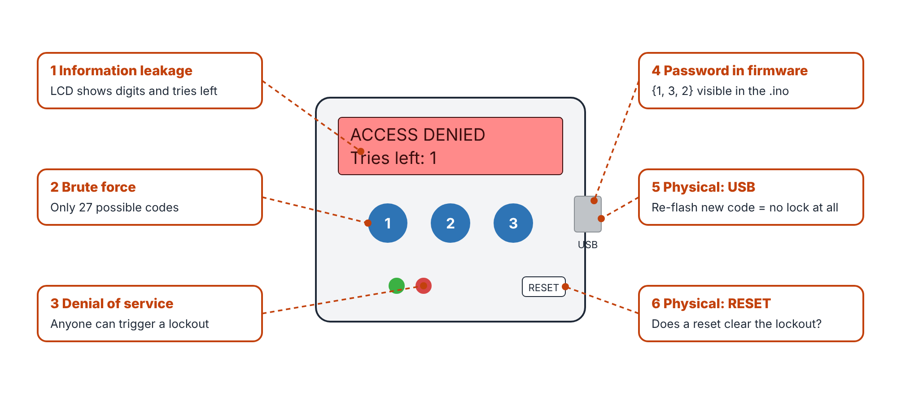

# Secure Access Control (ET4047 · Week 10 · Lab 9)

**Module:** ET4047 · **Author:** Luke Griffin
**University of Limerick — Department of Electronic & Computer Engineering**

📄 **View the full lab document online:** https://lukegrif.github.io/W10-LAB-ET4047/viewer.html?lab=secure

---

## Overview

Enter a 3-button code. Correct: green LED and **ACCESS GRANTED**. Wrong: red LED
and **ACCESS DENIED**. Three wrong codes: **LOCKOUT** for 10 s. Then switch sides,
attack the lock, and fix what you find.

### Learning outcomes

- Read buttons reliably with `INPUT_PULLUP` and software debouncing.
- Write an embedded program as a finite state machine.
- Time events with `millis()` instead of `delay()`.
- Spot common security weaknesses in an embedded device and fix some of them.

### What you need

| Item | Qty |
|------|-----|
| Arduino Nano or Nano Every | 1 |
| Push buttons | 3 |
| LEDs + 220 Ω resistors (green, red) | 2 |
| 16×2 LCD with I2C backpack, **or** Adafruit RGB LCD shield | 1 |
| Slide switches or jumper wires (Extension only) | 3 |

Libraries (Arduino Library Manager): **LiquidCrystal I2C** (Frank de Brabander)
and **Adafruit RGB LCD Shield Library**. `lab_lcd.h` detects which LCD is fitted.

### Wiring

| Part | Pin | Part | Pin |
|------|-----|------|-----|
| B1 / B2 / B3 | D2 / D3 / D4 | Green LED | D8 |
| SW1 / SW2 / SW3 | D5 / D6 / D7 | Red LED | D9 |
| LCD SDA | A4 | LCD SCL | A5 |

Buttons and switches go pin → part → GND. LEDs go pin → 220 Ω → LED → GND.

---

## Tasks

| # | Task | Time | Sketch |
|---|------|------|--------|
| 1 | Hardware test | 15 min | [`Task1_IO_Test`](Code/Task1_IO_Test/Task1_IO_Test.ino) |
| 2 | Debouncing and code entry | 20 min | [`Task2_Debounce`](Code/Task2_Debounce/Task2_Debounce.ino) |
| 3 | The finite state machine | 20 min | [`Task3_FSM`](Code/Task3_FSM/Task3_FSM.ino) |
| 4 | Attempt counter and lockout | 20 min | [`Task4_Lockout`](Code/Task4_Lockout/Task4_Lockout.ino) |
| 5 | Cybersecurity challenge | 20 min | [`Task5_Secure`](Code/Task5_Secure/Task5_Secure.ino) |
| Ext | Operating modes with switches | optional | [`Extension_Switches`](Code/Extension_Switches/Extension_Switches.ino) |

Each folder opens directly in the Arduino IDE and already contains the tabs it
needs (`lab_lcd.h`, and `buttons.h` from Task 3 on).

### Codes

| Mode | Code |
|------|------|
| Normal | 1-3-2 |
| Maintenance (Extension, SW3 ON) | 3-2-1 |

### What Task 5 changes

| Fix | Change | Attack it slows down |
|-----|--------|----------------------|
| [1] | Code masked as `* * _` | Shoulder surfing |
| [2] | No "tries left" on the denied screen | Information leakage |
| [3] | Progressive lockout 10 → 20 → 40 … 160 s | Brute force |
| [4] | Failed attempts kept in EEPROM | RESET / power cycle during lockout |
| [5] | Every digit always compared | Timing |

---

## Repository Contents

| Path | Description |
|------|-------------|
| `W10_LAB_Secure_Access_Control.pdf` | The lab document |
| `W10 LAB Secure Access Control.docx` | Editable Word version |
| `Code/` | One folder per task, ready to open in the Arduino IDE |
| `images/` | Figures used in the lab document |
